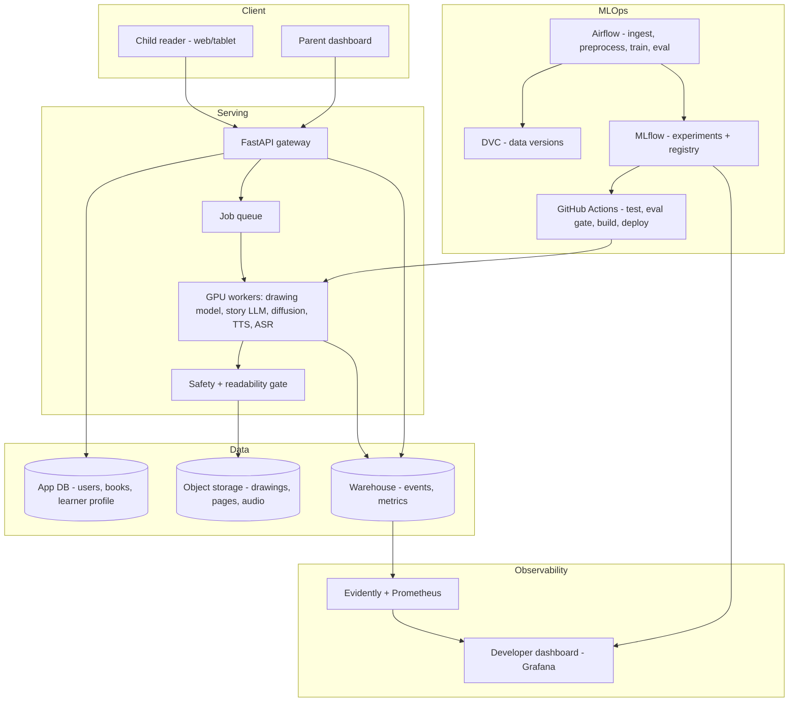
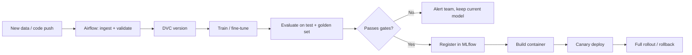

# Young Illustrator's Primer

**A child draws characters and scenes. The Primer turns them into a personalized, illustrated, narrated storybook written at the child's reading level and built around the words their parent wants them to learn.**

MLOps course team project, inspired by Y Combinator's *"The Primer"* request for an adaptive AI reading tutor for kids. The name nods to the *Young Lady's Illustrated Primer* from Neal Stephenson's *The Diamond Age*.

> **Status:** Week 1 (scoping and setup). The repository skeleton is in place, and no code is runnable yet. See [docs/project_scoping.md](docs/project_scoping.md) for the full plan.

---

## Contents

- [What it does](#what-it-does)
- [Architecture](#architecture)
- [Models](#models)
- [Data](#data)
- [MLOps stack](#mlops-stack)
- [Repository layout](#repository-layout)
- [Getting started](#getting-started)
- [Success targets](#success-targets)
- [Timeline](#timeline)
- [Child privacy and safety](#child-privacy-and-safety)
- [Team](#team)
- [Dataset attributions](#dataset-attributions)

---

## What it does

| Problem | Our solution |
|---|---|
| Generic books don't hold kids' interest | Stories star the child's own drawings |
| Parents can't tell which words their child knows | Target-word selection and tracking of words mastered |
| Practice needs an adult present | TTS narration, plus optional read-aloud speech recognition that flags misread words |

**Who it's for**

- **Ages 3–5, *Learn to Read*:** sight words, short pages, narration with word highlighting.
- **Ages 5–8, *Grow Vocabulary*:** richer words, longer stories, a glossary, and comprehension questions.
- **Parents:** a dashboard to set goals, target words, and book length, and to turn read-aloud mode on or off.
- **Dev team:** an internal dashboard for model health, usage, cost, and KPIs.

**How a book is made**

1. The child uploads drawings, and the child or parent labels each one.
2. The drawing recognizer extracts characters, objects, and attributes.
3. The story LLM writes a story around those characters, using the parent's target words at the child's reading level.
4. The readability scorer and safety filter check every page; pages that fail are regenerated.
5. The illustration model draws each page in the style of the child's art.
6. TTS narrates the book. If read-aloud mode is on, Whisper listens as the child reads and logs misread words to their learner profile.

## Architecture



**Training and deployment flow**



**Cloud:** GCP or AWS, to be decided in Week 1 (the team leans toward GCP). Pipeline code stays cloud-agnostic until then.

## Models

| Component | Base model (candidates) | Fine-tuning | Owned / pretrained |
|---|---|---|---|
| Drawing recognizer | SigLIP / CLIP / ConvNeXt; Florence-2 for attributes | Classification + caption fine-tune on Quick, Draw! + Amateur Drawings | **Owned** |
| Story generator | Small instruction LLM (Llama 3.x 1–3B / Qwen 2.5 / Phi) | LoRA / QLoRA on StoryWeaver + TinyStories instruction pairs | **Owned** |
| Readability scorer | DistilBERT / DeBERTa-v3 | Regression on CLEAR + StoryWeaver levels | **Owned** |
| Illustration | Stable Diffusion (SDXL / 1.5) + ControlNet-Scribble + IP-Adapter | Style LoRA on CC-BY storybook illustrations | **Owned (LoRA)** |
| Safety filter | Moderation classifier (e.g., toxic-BERT) | Optional fine-tune on children's-content rules | Pretrained → owned |
| Narration (TTS) | Kokoro / Parler-TTS / Piper | None | Pretrained |
| Read-aloud ASR | Whisper (small / medium) | Evaluate on MyST; optional fine-tune | Pretrained → optional owned |

All base models come from Hugging Face.

## Data

**Only open-licensed data is used** (CC-BY, public domain, or research-licensed). Each record keeps its title, author, illustrator, and license in its metadata. See [Dataset attributions](#dataset-attributions).

| Dataset | Used for |
|---|---|
| StoryWeaver, African Storybook | Illustrated, reading-level-tagged children's books |
| TinyStories, Project Gutenberg (children's) | Story-generation training text |
| Quick, Draw!, Amateur Drawings | Child-style drawing recognition |
| CLEAR Corpus | Readability scoring |
| MyST | Children's speech for ASR evaluation |

Raw and processed data is versioned with DVC in cloud object storage. It is never committed to git.

## MLOps stack

| Concern | Tool |
|---|---|
| Orchestration | Apache Airflow |
| Data versioning | DVC |
| Experiment tracking and model registry | MLflow |
| CI/CD | GitHub Actions, with an evaluation gate before deploy |
| Serving | FastAPI on containers, with an async GPU worker queue |
| Monitoring | Evidently (drift), Prometheus and Grafana (system and KPIs) |
| Infrastructure | Docker, Terraform |

## Repository layout

```
young-illustrators-primer/
├── .github/workflows/        # CI/CD: lint, tests, build, deploy
├── app/                      # Web app (child reader + parent dashboard)
├── dags/                     # Airflow DAGs (ingestion, preprocessing, training, eval)
├── dashboards/               # Developer monitoring dashboard configs (Grafana)
├── data/                     # DVC-tracked data (pointers only, not committed)
├── docs/                     # Scoping doc and design notes
├── infra/                    # Terraform, Docker, deployment configs
├── notebooks/                # EDA and experiments
├── src/
│   ├── data/                 # Loaders, PDF extraction, validation
│   ├── drawing/              # Drawing recognizer and attribute extraction
│   ├── story/                # LLM fine-tuning, prompting, constraints
│   ├── readability/          # Readability scorer
│   ├── illustration/         # Diffusion + ControlNet + style LoRA
│   ├── speech/               # TTS narration and read-aloud ASR
│   ├── safety/               # Content filters
│   └── serving/              # FastAPI inference service
└── tests/                    # Unit and integration tests
```

## Getting started

Setup instructions will be added as each workstream lands. They will cover:

- environment setup and dependencies
- cloud credentials and the DVC remote
- running the data pipelines, training, and the serving API locally
- deployment

### Contributing

- Branch off `main` (`feature/<area>-<short-description>`) and open a pull request. Don't push directly to `main`.
- At least one teammate reviews each PR before merge.
- Never commit data, model weights, credentials, or `.env` files. The [.gitignore](.gitignore) blocks the common cases.
- Use only open-licensed data, and record its license and attribution.

## Success targets

- ≥ 95% of target words included in each book
- Reading level within ±1 of target for ≥ 85% of books
- Zero safety violations on the golden test set
- Full book generated in ≤ 2 minutes, at ≤ $0.25 per book
- Parent satisfaction ≥ 4/5 in the pilot

## Timeline

| When (2026) | Milestone |
|---|---|
| Oct 5 – Oct 25 | Repo, cloud setup, data pipelines, dataset v1, baselines |
| Oct 26 – Nov 15 | Fine-tune models, end-to-end pipeline deployed, parent dashboard, ASR |
| Nov 16 – Nov 30 | CI/CD, monitoring and dev dashboard, hardening. **Code freeze Nov 30** |
| Dec 1 – Dec 14 | QA, safety red-teaming, pilot with ≥ 5 families, final report and demo |

## Child privacy and safety

The product handles children's drawings and voices, so privacy and safety are requirements, not extras.

- **COPPA:** accounts belong to parents; verifiable parental consent is required; we store as little as possible and delete on request.
- **No child data in this repo:** pilot data stays in access-controlled cloud storage.
- **Safety gate:** every generated page passes text and image safety filters, and deployment is blocked if the golden-set safety tests fail.

## Team

Rutvij Surti · Kush Patel · Keith Fernandes · Rishi Parekh · Diya Kaswa · Adit Vakil

## Dataset attributions

- **StoryWeaver**, Pratham Books, [storyweaver.org.in](https://storyweaver.org.in), CC-BY-4.0
- **African Storybook**, [africanstorybook.org](https://www.africanstorybook.org), CC-BY-4.0
- **TinyStories**, Eldan & Li (2023), [huggingface.co/datasets/roneneldan/TinyStories](https://huggingface.co/datasets/roneneldan/TinyStories)
- **Project Gutenberg**, [gutenberg.org](https://www.gutenberg.org), public domain
- **Quick, Draw! Dataset**, Google Creative Lab, [github.com/googlecreativelab/quickdraw-dataset](https://github.com/googlecreativelab/quickdraw-dataset), CC-BY-4.0
- **Amateur Drawings Dataset**, Meta AI, [github.com/facebookresearch/AnimatedDrawings](https://github.com/facebookresearch/AnimatedDrawings)
- **CLEAR Corpus**, CommonLit & Georgia State University, [github.com/scrosseye/CLEAR-Corpus](https://github.com/scrosseye/CLEAR-Corpus), CC-BY-NC-SA-4.0
- **MyST** (My Science Tutor) children's speech corpus, [boulderlearning.com](https://boulderlearning.com), free for non-commercial research (access by request)

Licenses for each dataset are verified before it is used for training. CLEAR and MyST are non-commercial: fine for this academic project, but they would need replacing before any commercial launch.
