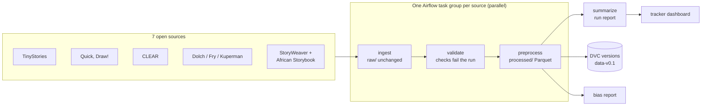

# Young Illustrator's Primer

A child draws characters and scenes. The Primer turns those drawings into a personalized, illustrated, narrated storybook written at the child's reading level and built around words their parent wants them to learn.

This is our MLOps course team project (IE 7374), inspired by Y Combinator's *"The Primer"* request for an adaptive AI reading tutor for kids.

> **Status:** the **data pipeline** is built and running: seven open datasets are downloaded, validated, cleaned, versioned with DVC and orchestrated with Airflow. Model training starts next. This README documents the data pipeline end to end.

## Contents

1. [The data pipeline at a glance](#1-the-data-pipeline-at-a-glance)
2. [Reproduce it on your machine](#2-reproduce-it-on-your-machine) (no cloud account needed)
3. [Data sources](#3-data-sources)
4. [Pipeline stages](#4-pipeline-stages): acquisition, validation, preprocessing, schemas, statistics and anomalies
5. [Orchestration with Airflow](#5-orchestration-with-airflow)
6. [Data versioning with DVC](#6-data-versioning-with-dvc)
7. [Tracking, logging and error handling](#7-tracking-logging-and-error-handling)
8. [Bias detection and mitigation](#8-bias-detection-and-mitigation)
9. [Tests and CI](#9-tests-and-ci)
10. [Code structure](#10-code-structure)
11. [Configuration and the shared bucket](#11-configuration-and-the-shared-bucket)
12. [Known gaps and next steps](#12-known-gaps-and-next-steps)
13. [More docs, contributing, team](#13-more-docs-contributing-team)

---

## 1. The data pipeline at a glance



| Dataset (`processed/`) | Rows today | Used by |
|---|---|---|
| `drawings` | 632,746 | drawing recognizer |
| `stories_text` | 54,642 | story LLM |
| `word_lists` | 32,323 | target-word selection |
| `storybook_pages` | 7,142 pages (with illustrations) | illustration style, readability |
| `readability` | 4,723 | readability scorer |

Everything lives in the GCS bucket `gs://young-illustrators-primer-data` for the team, or in a local folder when you reproduce it (section 2).

## 2. Reproduce it on your machine

You need **Docker Desktop** (or Docker Engine with Compose v2.24+, about 4 GB of memory for Docker) and **git**. No Google Cloud account is needed: by default everything is written to `.local-data/` inside the clone.

```bash
git clone https://github.com/keithfernandes12/young-illustrators-primer.git
cd young-illustrators-primer
cp .env.example .env                 # on Linux, set AIRFLOW_UID to the output of `id -u`
docker compose up airflow-init       # once: builds the image, creates the Airflow DB and admin user
docker compose up -d                 # start Airflow 3.3
```

1. Open **http://localhost:8080** and sign in (the local login is set in `.env`; default `airflow` / `airflow`).
2. Unpause **`primer_data_pipeline`** and click **Trigger**.
3. For a quick first run, set `sources` to e.g. `["clear_corpus", "sight_words", "kuperman_aoa", "tinystories"]`. The two picture-book sources stream about 750 MB of images.
4. Watch the tasks in the **Grid** view; each task's log is one click away. Results land in `.local-data/processed/`, and the run report in `.local-data/metadata/reports/`.

```bash
docker compose down                  # stop (add -v to also delete the Airflow database)
```

**Without Docker** (Python 3.11+), for the CLI and tests:

```bash
pip install -e ".[dev,dvc]"
pytest                                                  # the test suite
primer-data --data-uri .local-data sources              # list sources
primer-data --data-uri .local-data run clear_corpus     # ingest + validate + preprocess one source
```

Dependencies are declared in [`pyproject.toml`](pyproject.toml) (extras: `dev`, `dvc`, `dashboard`). The Airflow image pins `apache-airflow==3.3.2` in [`infra/airflow/Dockerfile`](infra/airflow/Dockerfile).

## 3. Data sources

Only open datasets, downloaded by code (no manual steps). Each processed record keeps its `license` and `attribution`.

| Source | What it gives us | How it's fetched | Kind |
|---|---|---|---|
| **TinyStories** (Eldan & Li, 2023) | ~2.1M short children's stories | Hugging Face dataset, streamed in batches | incremental |
| **Quick, Draw!** (Google) | doodles of 345 everyday objects | public GCS bucket, first 2,000 per category | incremental |
| **CLEAR Corpus** (CommonLit) | 4,724 excerpts with teacher-rated readability | spreadsheet in the CLEAR GitHub repo | snapshot |
| **Dolch / Fry** sight words | 220 + 1,000 words by grade / frequency | `lexicon` R package data files | snapshot |
| **Kuperman AoA** norms | age of acquisition for ~31k words | Brysbaert's OSF file | snapshot |
| **StoryWeaver** (Pratham Books) | 391 illustrated books, page text + images + captions | Global Storybooks GitHub mirror | snapshot |
| **African Storybook** | 363 illustrated books, page text + images | Global Storybooks GitHub mirror | snapshot |

- **Incremental** sources continue where the last run stopped (position saved in `metadata/state/<source>.json`).
- **Snapshot** sources re-download a fixed file or repo and make a new batch only when it changed; otherwise the run reports "nothing new" and skips.

The registry with URLs, licenses and per-source settings is [`configs/sources.yaml`](configs/sources.yaml).

## 4. Pipeline stages

Every source implements the same three stages ([`src/primer/data/sources/base.py`](src/primer/data/sources/base.py)):

| Stage | What it does | Output |
|---|---|---|
| **ingest** (acquisition) | Download the next batch exactly as published | `raw/<source>/<batch_id>/` (never modified) |
| **validate** | Source-specific checks: record counts, required fields, unique ids, empty or malformed records, value ranges, image coverage and page/image alignment. **Any failed check fails the run** before anything reaches `processed/` | checks recorded in the run manifest |
| **preprocess** | Clean and transform into one schema per dataset type: Unicode/whitespace normalization, length filters, exact-duplicate removal (within the batch and against earlier batches), stroke and image metadata, page/illustration alignment, label normalization | `processed/<dataset>/source=<source>/batch=<id>.parquet` |

Schemas are defined once in [`src/primer/data/schemas.py`](src/primer/data/schemas.py) (`STORIES_TEXT`, `DRAWINGS`, `READABILITY`, `WORD_LISTS`, `STORYBOOK_PAGES`) and every source is forced into them, so model code reads all sources of a dataset together:

```python
from primer.data.catalog import read_dataset
drawings = read_dataset("drawings")                    # current data
drawings_v01 = read_dataset("drawings", version="v0.1")  # exactly as frozen in a version
```

**Anomalies the checks have already caught** in real data: a README parsed as a story, back-cover blurbs hiding credits, empty stories in a mirror, a duplicated word in the Fry list, and nine CLEAR excerpts with no publication year. Tests caught two more before they reached real data: Excel turning "900" into "900.0", and same-second batches overwriting each other. Each one now has a regression test.

**Statistics, schema and anomaly detection** ([`profiling.py`](src/primer/data/profiling.py)). The checks above look at one batch; after every run, `check_data` looks at each dataset as a whole:

- **Statistics:** per column, the null fraction, min/max/mean/std/percentiles for numbers, and length, distinct count and category shares for text, saved to `metadata/profiles/<dataset>/<run_id>.json`.
- **Schema:** [`configs/schemas/<dataset>.json`](configs/schemas/) is each dataset's contract (exact columns, minimum rows, maximum null fraction, numeric ranges, non-empty text, allowed categories). It is inferred from known-good data with `primer-data profile --write-schemas`, reviewed and committed, so changing what counts as valid data goes through a PR. **Great Expectations** validates every dataset against it; a failure is an **error and fails the run**, as is a dataset that lost all its rows or has no schema. Exceeding the top of a numeric range is only a warning, since growing sources legitimately do.
- **Drift:** each profile is compared with the previous one. Rows down more than 5%, nulls up more than 5 points, a mean moving more than half a standard deviation (or at all, if it was constant), mean text length changing more than 30%, category shares moving more than 0.15 (total variation distance), or a column crossing between categorical and open-ended is a **warning**.
- Errors, warnings and failed tasks are **emailed** (section 7). `primer-data profile` runs the same check by hand and only reads.

## 5. Orchestration with Airflow

[`dags/primer_data_pipeline.py`](dags/primer_data_pipeline.py) runs one task group per source, all in **parallel**, then `summarize` and `check_data`:

```
tinystories        ingest → validate → preprocess ─┐
quickdraw          ingest → validate → preprocess ─┤
clear_corpus       ingest → validate → preprocess ─┤
sight_words        ingest → validate → preprocess ─┼──→ summarize, check_data
kuperman_aoa       ingest → validate → preprocess ─┤
storyweaver        ingest → validate → preprocess ─┤
african_storybook  ingest → validate → preprocess ─┘
```

- **Skips:** a source with nothing new skips its ingest and the rest of its group.
- **Failures:** a failed validation fails that source; `summarize` still writes the report (each source's outcome and row counts in `metadata/reports/`) and then **fails the run**, naming the failed sources.
- **Data check:** `check_data` profiles, validates and drift-checks every dataset (section 4); schema errors fail the run.
- **Retries:** only downloads retry (3×, exponential backoff); validation never retries, because the data won't change.
- **Safety:** `max_active_runs=1` (incremental positions can't race), `schedule=None` and `catchup=False` (no surprise backfills), new DAGs start paused.
- **Trigger parameters:** `sources`, `tinystories_batch_size`, `quickdraw_categories`.

[`dags/primer_freeze_version.py`](dags/primer_freeze_version.py) freezes a dataset version from the UI (section 6). Every task calls a plain Python function in [`src/primer/data/orchestration.py`](src/primer/data/orchestration.py), so the logic is tested without Airflow. More: [`dags/README.md`](dags/README.md).

**Flow optimization.** The sources are independent, so they run as parallel groups instead of one chain, and the run takes about as long as its slowest source rather than the sum of all of them. Measured on a real run that fetched 50,000 TinyStories: `ingest` 18 s, `validate` 6 s, `preprocess` 16 s, `summarize` 9 s, 51 s end to end. The **Gantt** view of a run (Airflow UI → run → Gantt) shows the groups overlapping and which task is the bottleneck: the picture-book image downloads when those sources change, TinyStories otherwise.

## 6. Data versioning with DVC

The bucket has **object versioning** on, so a replaced file keeps its old copy. A dataset version records the exact GCS object generation of every processed file:

```bash
primer-data version v0.2 -m "what changed"   # freeze; writes metadata/versions/v0.2.json
primer-data dvc-pointers                     # refresh data/*.dvc (no data downloaded or copied)
git add data/*.dvc && git commit -m "chore(data): data version v0.2 (KAN-<n>)" && git tag data-v0.2
```

- [`data/*.dvc`](data/) are DVC `import-url --version-aware` pointers: they record the same object versions **without storing any data in git or the DVC cache**.
- Versions are permanent (a tag can't be overwritten). The first one, **`data-v0.1`**, is tagged in git.
- Get a version back: `git checkout data-v0.1 && dvc pull data/drawings.dvc`, or in Python `read_dataset(..., version="v0.1")`.

Details: [`src/primer/data/README.md`](src/primer/data/README.md) → Versions.

## 7. Tracking, logging and error handling

- **Run manifests:** every stage run writes `metadata/runs/<run_id>.json` (status, timings, record counts in/out, validation checks, error message). Failures are recorded and re-raised, never swallowed.
- **Run reports:** `summarize` writes per-run outcomes and row counts to `metadata/reports/`.
- **Logs:** Python `logging` throughout; Airflow keeps every task's log (UI and `logs/`). A failure callback logs the task, run, try number and exception.
- **Alerts** ([`alerts.py`](src/primer/data/alerts.py)): a failed task emails `PRIMER_ALERT_EMAILS` with the task, run and error (schema errors include the full anomaly list), and `check_data` emails drift warnings. Plain SMTP configured in `.env`; off until set, and a mail failure is logged rather than failing the task. Test it with `primer-data test-alert`.
- **Tracker dashboard** ([`dashboards/tracker/`](dashboards/tracker/README.md)): a Streamlit page with a "what's happened" feed of pipeline batches and dataset versions, per-source status and record counts, and open tasks.
- **Error handling:** retries with backoff on network steps, validation that fails fast, the raw batch written before the source's position advances (so an interrupted download is fetched again rather than skipped), and same-second batch ids made unique so back-to-back runs can't overwrite raw files.

## 8. Bias detection and mitigation

`primer-data bias-report` slices every dataset with **Fairlearn** (`MetricFrame`) and writes [`reports/bias/bias_report.md`](reports/bias/bias_report.md). Our data has no information about people, so it slices on what the data does have:

| Slice | Finding | Mitigation |
|---|---|---|
| Drawings by **country** | the US is 44.9% of drawings; the game's own recognizer ranges from 89.5% (Thailand) to 95.5% (Brazil) | capped sample weights: no country above 20% of training weight, no data dropped |
| Stories by **lead-character gender** | picture books skew male (African Storybook +20 points, StoryWeaver +14); TinyStories is balanced | gender-swap augmentation, balanced per source |
| Readability by **genre and era** | the Flesch-Kincaid baseline rates 1900–1949 texts too easy and modern texts too hard | splits stratified by genre × era, evaluated per slice |
| Picture books by **origin** | illustrations 55% African / 45% Indian | none needed; re-checked on every run |

The report explains each finding, the mitigation and its trade-offs, and is regenerated from code whenever data changes.

## 9. Tests and CI

```bash
pytest                         # all tests; no network, never touches the bucket
pytest tests/data              # pipeline tests only
ruff check . && mypy src       # lint and type-check
```

- **Pipeline tests** (`tests/data/`) run every source against fake fetchers and a temporary local store: edge cases, missing values, malformed records, failed validation, deduplication, versioning, and regression tests for every bug found in real data. A guard makes any test that tries to reach GCS fail.
- **DAG tests** (`tests/dags/`) load the DAGs with Airflow's `DagBag` and check the wiring, retries and parameters. Airflow doesn't run on Windows, so they run inside the containers: see [`dags/README.md`](dags/README.md) → Tests.
- **CI** (GitHub Actions): `ruff`, `mypy` and `pytest` on every pull request and push to `main`, plus a check that PR titles and commits follow `type(scope): summary (KAN-<n>)`. See [`docs/engineering/ci.md`](docs/engineering/ci.md).

## 10. Code structure

Laid out like a Python library (one installable package, `primer`, with the pipeline in `primer.data`), plus the orchestration and infrastructure around it:

```
young-illustrators-primer/
├── src/primer/data/            the data pipeline package
│   ├── sources/                one module per source: ingest / validate / preprocess
│   ├── pipeline.py             runs a stage with a run manifest
│   ├── orchestration.py        Airflow-free entry points the DAGs call
│   ├── storage.py              one API for GCS or a local folder
│   ├── schemas.py              standard columns per dataset
│   ├── profiling.py            statistics, Great Expectations validation, drift
│   ├── alerts.py               email alerts
│   ├── catalog.py              read_dataset(), current or by version
│   ├── versioning.py           dataset versions + DVC pointers
│   ├── manifest.py, checks.py, text.py, config.py
│   └── cli.py                  the primer-data command
├── dags/                       Airflow DAGs (+ README)
├── configs/sources.yaml        dataset registry
├── configs/schemas/            per-dataset data contracts (Great Expectations)
├── data/*.dvc                  DVC pointers to versioned data (no data in git)
├── tests/                      pytest: data/, dags/, agent_hooks/
├── dashboards/tracker/         Streamlit tracker
├── infra/airflow/Dockerfile    Airflow image with the package installed
├── docker-compose.yaml         Airflow (local data by default)
├── docker-compose.gcs.yaml     override: write to the shared bucket
├── reports/bias/               generated bias report
├── docs/                       scoping, engineering process, plans
└── src/primer/{drawing,story,readability,illustration,speech,safety,serving}/   model packages (next)
```

## 11. Configuration and the shared bucket

| Setting | Where | Default |
|---|---|---|
| Data root | `PRIMER_DATA_URI` env var or `--data-uri` | `.local-data/` in Docker; `gs://young-illustrators-primer-data` for the CLI |
| Dataset registry | `configs/sources.yaml` (or `PRIMER_SOURCES_FILE`) | — |
| Airflow user, login | `.env` (from `.env.example`) | `airflow` / `airflow`, local only |
| Alert emails | `PRIMER_ALERT_EMAILS`, `PRIMER_SMTP_*` in `.env` | off |

**Team members** with access to the `young-illustrators-primer` GCP project write to the bucket instead of the local folder: run `gcloud auth application-default login`, set `GCLOUD_CONFIG_DIR` in `.env`, and start Airflow with `docker compose -f docker-compose.yaml -f docker-compose.gcs.yaml up -d` (or put `COMPOSE_FILE=docker-compose.yaml;docker-compose.gcs.yaml` in `.env`). Credentials are mounted read-only into the scheduler only; no service-account keys are ever created.

## 12. Known gaps and next steps

Being explicit about what isn't done yet:

- **Alerts beyond email**: a Slack channel, and alerts for the model and serving side once those exist.
- **Feature engineering**: rendering Quick, Draw! strokes to images, a safety filter for text, and mapping readability levels onto one scale are next.
- **Splits**: by-book train/validation/test splits and the golden evaluation set.
- Follow-ups from code review (tracked on the merged PRs): bind the Airflow UI to localhost only, unique run-manifest ids, and running the DAG tests in CI.

## 13. More docs, contributing, team

- **[Project summary (1 page)](docs/project_scoping_tldr.md)** and the **[full scoping document](docs/project_scoping.md)**.
- **[Getting started as a new teammate](docs/engineering/onboarding.md)**: set up your clone, then what to read in which order. Working on the code? Read **[AGENTS.md](AGENTS.md)**, the rules everyone and every agent follows.
- **[Data pipeline reference](src/primer/data/README.md)** · **[Airflow DAGs](dags/README.md)** · **[Tracker dashboard](dashboards/tracker/README.md)**

**Contributing:** branch off `main` as `<type>/KAN-<n>-<slug>`, commit as `type(scope): summary (KAN-<n>)`, and open a draft pull request; at least one teammate reviews each PR before it merges. Never commit data, model weights, credentials, or `.env` files. Record each new dataset's source, license and attribution in `configs/sources.yaml`.

**Team:** Rutvij Surti · Kush Patel · Keith Fernandes · Rishi Parekh · Diya Kaswa · Adit Vakil
