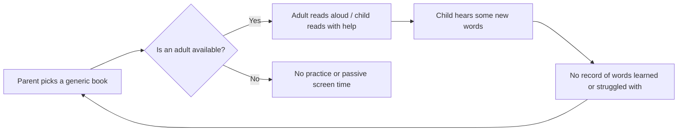
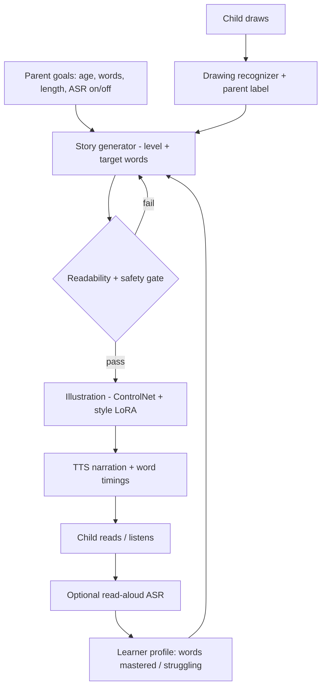
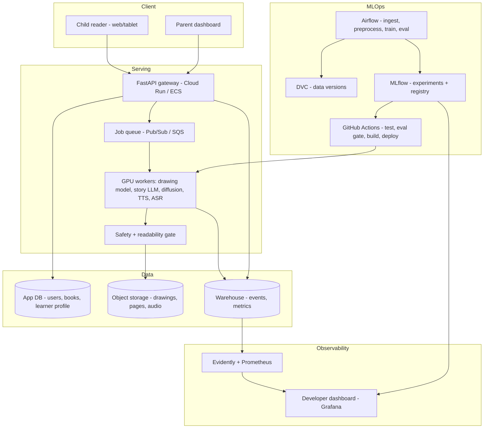
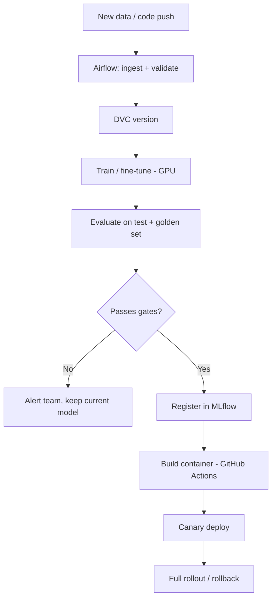

# Project Scoping Submission - Young Illustrator's Primer

**Team Members:**
- Rutvij Surti
- Kush Patel
- Keith Fernandes
- Rishi Parekh
- Diya Kaswa
- Adit Vakil

---

## 1. Introduction

**Young Illustrator's Primer** turns a child's own drawings into personalized, illustrated, narrated storybooks that teach reading and vocabulary.

A child draws characters and scenes (a purple dragon, a house on a cloud). The system recognizes what was drawn, turns it into the cast and setting of a short story, writes the story at the child's reading level around words the parent wants them to learn, illustrates each page in a consistent storybook style that keeps the child's design, and narrates it with text-to-speech. An optional read-aloud mode listens to the child read and detects words they struggle with, so the next story can adapt.

The product serves two age groups with different learning goals:

| Age Group | Mode | Learning Goal | Key Features |
|---|---|---|---|
| **3–5** | *Learn to Read* | Letter-sound awareness, sight words, first vocabulary | 1–2 short sentences per page, 4–8 pages, narration on by default, word-by-word highlighting, tap any word to hear it, target words repeated 3+ times |
| **5–8** | *Grow Vocabulary* | Richer vocabulary ("Tier 2" words) and command of language | Longer sentences, 8–16 pages, new words explained in context, end-of-book glossary, comprehension questions, read-aloud fluency practice |

**Parents** use a guidance dashboard to set learning goals (target words, phonics focus, a theme or life lesson), book length, difficulty, and whether read-aloud speech recognition is on.

**The development team** has an internal dashboard to track model performance, usage, cost, and product KPIs.

The idea responds to Y Combinator's Request for Startups *"The Primer"* ([ycombinator.com/rfs](https://www.ycombinator.com/rfs#the-primer)). The brief calls for an AI tutor that teaches young children to read, adapts to the individual child, and supplements (rather than replaces) parents and teachers. Young Illustrator's Primer is a first step: an engine that personalizes reading practice and is built on the child's own imagination.

---

## 2. Dataset Information

### 2.1 Dataset Introduction

The system needs data for five learning tasks. The training data must look like what the model will see in production (child-style drawings, children's story text at graded levels, children's speech), and it must be legally usable. We therefore use **openly licensed or public-domain sources only**.

| Task | What the data teaches the model | Primary datasets |
|---|---|---|
| Drawing understanding | Recognize what a child drew and describe its attributes | Quick, Draw!, Amateur Drawings |
| Story generation | Write coherent children's stories at a target reading level using target words | StoryWeaver, African Storybook, TinyStories, Project Gutenberg (children's) |
| Readability scoring | Check that generated text matches the target reading level | CLEAR Corpus, StoryWeaver reading levels |
| Illustration style | Render pages in a consistent storybook style from a child's sketch | StoryWeaver + African Storybook illustrations |
| Read-aloud speech recognition | Transcribe children's speech and detect misread words | MyST Children's Speech Corpus (evaluation / optional fine-tune) |

Supporting resources: **Dolch and Fry sight-word lists** (target words for ages 3–5) and **Kuperman age-of-acquisition norms** (rank vocabulary by the age at which words are typically learned, used for ages 5–8).

### 2.2 Data Card

> _Sizes and licenses are from public documentation and will be confirmed during ingestion (Week 1–2)._

| Dataset | Size (approx.) | Format | Data Types | License | Used For |
|---|---|---|---|---|---|
| **StoryWeaver** (Pratham Books) | Tens of thousands of stories across hundreds of languages (English subset used) | PDF / ePub + metadata | Images (illustrations), text per page, reading level 1–4, language, tags | CC-BY 4.0 | Story generation, readability labels, illustration style |
| **African Storybook** | Thousands of picture books in many languages | PDF / web + metadata | Images, text, reading level | CC-BY | Story generation, illustration style (cultural diversity) |
| **TinyStories** (Microsoft) | ~2M short stories | JSON / text (HF dataset) | Text | CDLA-Sharing-1.0 | Story generation at a young reading level |
| **Project Gutenberg** (children's subset) | Hundreds of books | Text / HTML | Text | Public domain | Story structure and narrative style |
| **Quick, Draw!** (Google) | ~50M drawings, 345 categories | NDJSON strokes / 28×28 bitmaps | Vector strokes, category label | CC-BY 4.0 | Drawing recognizer pre-training |
| **Amateur Drawings** (Meta) | ~178K drawings | Images + JSON annotations | Images, bounding boxes, masks, joint keypoints | Released by Meta AI for research use | Child-style drawing understanding |
| **CLEAR Corpus** (CommonLit) | ~4.7K excerpts | CSV | Text, readability scores, grade level | CC BY-NC-SA 4.0 | Readability scorer |
| **MyST Children's Speech** | ~400 hours | Audio + transcripts | Audio (WAV), text | Free for non-commercial research (access by request) | ASR evaluation / optional fine-tune |
| **Dolch / Fry word lists** | ~220 / 1,000 words | CSV | Text, grade level | Public domain | Target-word selection (3–5) |
| **Kuperman AoA norms** | ~30K words | CSV | Word, age-of-acquisition rating | Free for research | Target-word selection (5–8) |
| **YouTube (optional)** | TBD | Video → frames + transcript | Images, text | **CC-BY filtered only** | Optional extra image-text pairs |
| **User data (production)** | Grows with usage | Images, JSON, audio (opt-in) | Drawings, parent settings, interaction logs, read-aloud audio | Owned by parent account; COPPA consent | Feedback loop, monitoring, retraining |

### 2.3 Data Sources

- **StoryWeaver:** https://storyweaver.org.in (bulk download / API)
- **African Storybook:** https://www.africanstorybook.org
- **TinyStories:** https://huggingface.co/datasets/roneneldan/TinyStories
- **Project Gutenberg:** https://www.gutenberg.org (Children's bookshelf)
- **Quick, Draw!:** https://github.com/googlecreativelab/quickdraw-dataset
- **Amateur Drawings / Animated Drawings:** https://github.com/facebookresearch/AnimatedDrawings
- **CLEAR Corpus:** https://github.com/scrosseye/CLEAR-Corpus
- **MyST Corpus:** https://boulderlearning.com (request access)
- **Dolch / Fry lists:** public-domain education resources
- **Kuperman AoA norms:** Kuperman, Stadthagen-Gonzalez & Brysbaert (2012)
- **Pretrained models:** Hugging Face Hub (see Section 5.3)

### 2.4 Data Rights and Privacy

**Training data**
- Only **CC-BY, public-domain, or research-licensed** data is used. Attribution (title, author, illustrator, license) is kept in each record's metadata and credited in the app and the repository.
- **Copyrighted children's media (most YouTube channels, commercially published books) is excluded.** YouTube's Terms of Service also forbid downloading videos outside YouTube's own features. Any YouTube use is limited to videos marked Creative Commons and is optional.
- Non-commercial licenses (CLEAR, MyST) are fine for an academic project but would need to be replaced before any commercial launch.

**User (child) data** is the most sensitive part of this project:
- **COPPA (US)** and **GDPR / GDPR-K (EU/UK):** users under 13 cannot create accounts. All accounts are owned by a parent, and **verifiable parental consent** is required before any drawing or audio is processed.
- **Data minimization:** no child names, faces, or location are needed. Drawings and books are stored under a pseudonymous ID. Read-aloud audio is **processed in memory and discarded by default**; storing it to improve the model is a separate opt-in.
- **Right to delete:** parents can delete a child's drawings, books, and history at any time. Deletion also covers the training data (deleted items are excluded from future dataset versions).
- **Security:** encryption in transit (TLS) and at rest, least-privilege IAM, and no child data in logs or URLs.
- **Testing phase:** pilot users are children of consenting family and friends, with parents present. We will check with the instructor whether IRB-style approval is needed.

---

## 3. Data Planning and Splits

### 3.1 Loading (ingestion pipelines, orchestrated with Airflow)

```
StoryWeaver / ASB PDFs ──► PyMuPDF page splitter ──► illustration + text per page ─┐
Gutenberg / TinyStories ──► text loader ───────────────────────────────────────────┤
Quick, Draw! / Amateur Drawings ──► image/stroke loader ───────────────────────────┼──► Raw zone (GCS / S3)
CLEAR / word lists ──► CSV loader ─────────────────────────────────────────────────┤
(Optional) CC YouTube ──► scene detection ──► keyframes + transcript alignment ────┘
```

### 3.2 Preprocessing

| Data | Steps |
|---|---|
| **Storybook pages** | Extract text and image per page → OCR fallback for text inside images → remove front matter and credits → normalize text → link pages to book ID → attach reading level, word count, vocabulary profile |
| **Story text (LLM fine-tuning)** | Deduplicate (MinHash) → filter unsafe content (toxicity classifier) → build instruction pairs: `{age_group, level, target_words, pages, characters, setting}` → `story` |
| **Drawings** | Render strokes to images → resize and normalize → augment (rotation, line thickness, partial erasure, color fill) to look like real children's art |
| **Illustrations (style LoRA)** | Filter by resolution → deduplicate → auto-caption (VLM) → manual spot-check |
| **Readability** | Map StoryWeaver levels 1–4 and CLEAR grade scores onto one shared difficulty scale |
| **Speech** | Resample to 16 kHz → segment by utterance → align with transcripts |

### 3.3 Splits

| Dataset | Strategy | Ratio |
|---|---|---|
| Storybooks | **Split by book, not page** (so pages from one book can't appear in both train and test), stratified by reading level and language | 80 / 10 / 10 |
| Quick, Draw! / Amateur Drawings | Stratified by category | 80 / 10 / 10 |
| CLEAR | Stratified by grade band | 80 / 10 / 10 |
| MyST | Split by speaker (no speaker in more than one split) | 80 / 10 / 10 |
| **Golden evaluation set** | ~100 hand-written parent-setting scenarios (age, level, target words, sample drawings), fixed and used to compare every model version | Held out permanently |
| Production feedback data | Time-based split (train on older, validate on newer) for retraining | Rolling |

### 3.4 Managing Data

- **Storage zones:** `raw/` → `processed/` → `features/` in a cloud bucket (GCS or S3).
- **Versioning:** DVC tracks every dataset version, and each trained model records the dataset version it was trained on.
- **Validation:** Great Expectations / TFDV schema checks (missing text, empty pages, label distribution, image size) run as an Airflow task. The pipeline stops if a check fails.
- **Lineage and metadata:** source, license, and attribution travel with every record.

---

## 4. GitHub Repository

**Repository:** [ADD GITHUB LINK]

**Folder Structure (planned):**

```
young_illustrators_primer/
├── .github/workflows/        # CI/CD: lint, tests, build, deploy
├── dags/                     # Airflow DAGs (ingestion, preprocessing, training, eval)
├── data/                     # DVC-tracked (raw/processed pointers, not committed)
├── src/
│   ├── data/                 # loaders, PDF/frame extraction, validation
│   ├── drawing/              # drawing recognizer + attribute extraction
│   ├── story/                # LLM fine-tuning, prompting, constraints
│   ├── readability/          # readability scorer
│   ├── illustration/         # diffusion + ControlNet + style LoRA
│   ├── speech/               # TTS narration + read-aloud ASR
│   ├── safety/               # content filters
│   └── serving/              # FastAPI inference service
├── app/                      # Web app (child reader + parent dashboard)
├── dashboards/               # Developer monitoring dashboard configs (Grafana)
├── infra/                    # Terraform / Docker / deployment configs
├── notebooks/                # EDA and experiments
├── tests/                    # unit + integration tests
├── dvc.yaml                  # data/ML pipeline stages
├── requirements.txt
└── README.md
```

**README:** project overview, architecture diagram, setup (environment, credentials, DVC remote), how to run pipelines/training/serving locally, deployment steps, and dataset attributions.

---

## 5. Project Scope

### 5.1 Problems

Following the class framework, we start from the **business problem**, not the AI problem.

| # | Problem (what we want to achieve) |
|---|---|
| P1 | Young children lose interest in reading practice because generic books aren't about *them*. |
| P2 | Vocabulary growth is uneven, and parents don't know which words their child knows or should learn next. |
| P3 | Parents want to help but lack the time and teaching know-how to plan level-appropriate reading. |
| P4 | Pre-readers and early readers can't read independently, so practice depends on an adult being available. |
| P5 | Nobody gets feedback on *how* the child reads (which words they struggle with) unless an adult is listening. |

### 5.2 Current Solutions

| Solution | Examples | Gap |
|---|---|---|
| Physical / e-book libraries | Library books, Epic! | Not personalized; no tracking of progress |
| Leveled reading apps | Reading Eggs, Khan Academy Kids, Duolingo ABC | Fixed curriculum and content; the child's imagination plays no part |
| AI reading tutors | Ello (listens to kids read) | Adaptive, but built on pre-written books |
| AI story generators | Oscar Stories, GPT-based apps | Personalized, but no learning goals, weak safety, don't use the child's art |
| Drawing animation | Meta Animated Drawings | Engaging, but teaches nothing |

### 5.3 Proposed Solutions

| Problem | Solution (how) | Model / Component |
|---|---|---|
| P1 | Stories star the child's own drawn characters and worlds | Drawing recognizer + illustration pipeline |
| P2 | Target-word selection by age and level; tracking of words mastered | Word-selection logic + learner profile |
| P3 | Parent dashboard: set goals, length, difficulty; the system plans the lesson | Story generator with constraints + readability gate |
| P4 | Narration with word highlighting and tap-to-hear | TTS with word timestamps |
| P5 | Optional read-aloud mode detects misread words and adapts the next story | ASR + word alignment + adaptation |

**Models we will fine-tune (from Hugging Face):**

| Component | Base model (candidates) | Fine-tuning | Owned / Pretrained |
|---|---|---|---|
| Drawing recognizer | SigLIP / CLIP / ConvNeXt; Florence-2 for attributes | Classification + caption fine-tune on Quick, Draw! + Amateur Drawings | **Owned** |
| Story generator | Small instruction LLM (Llama 3.x 1–3B / Qwen 2.5 / Phi) | LoRA / QLoRA on StoryWeaver + TinyStories instruction pairs | **Owned** |
| Readability scorer | DistilBERT / DeBERTa-v3 | Regression on CLEAR + StoryWeaver levels | **Owned** |
| Illustration | Stable Diffusion (SDXL / 1.5) + ControlNet-Scribble + IP-Adapter | Style LoRA on CC-BY storybook illustrations | **Owned (LoRA)** |
| Safety filter | Moderation classifier (e.g., toxic-BERT) | Optional fine-tune on children's-content rules | Pretrained → owned |
| Narration (TTS) | Kokoro / Parler-TTS / Piper | None | Pretrained |
| Read-aloud ASR | Whisper (small / medium) | Evaluate on MyST; optional fine-tune | Pretrained → optional owned |

**Feasibility (lecture framework):**
- *Unstructured data, human-level performance (HLP):* humans often **cannot** tell what a 3-year-old drew. **Mitigation:** the child or parent names each drawing ("This is Zip, my dragon"). The model then extracts attributes (colors, shape, features) instead of guessing the subject.
- *External benchmarks:* TinyStories shows that small language models can write coherent children's stories. ControlNet-Scribble shows that diffusion models can follow a rough sketch. Whisper is a widely used baseline for speech recognition.
- *Predictive features for adaptation:* tapped words, misread words (ASR), reading time per page, and re-reads plausibly predict word mastery.

---

## 6. Current Approach Flow Chart and Bottleneck Detection

**How reading practice happens today (no Young Illustrator's Primer):**



**Bottlenecks**
1. **Adult availability:** practice only happens when a parent has time.
2. **Content mismatch:** books are too hard or too easy and not about the child, so engagement drops.
3. **No feedback loop:** nobody records which words the child knows, so the next book isn't chosen any better.
4. **Teaching know-how:** parents don't know how to sequence vocabulary or phonics.

**Proposed approach (with Young Illustrator's Primer):**



**Remaining bottlenecks in our pipeline, and how we address them**

| Bottleneck | Improvement |
|---|---|
| Image generation is slow and expensive (GPU) | Generate pages asynchronously and stream them as each finishes; cache character embeddings; use fewer diffusion steps (LCM / Turbo variants) |
| Regeneration loops when the readability/safety gate fails | Use constrained decoding and vocabulary-aware prompts so the first draft passes more often; cap retries |
| Misrecognized drawings | Ask the parent or child to label or confirm |
| Speech recognition is less accurate on young children's voices | Make ASR optional; use lenient matching; evaluate on and fine-tune with children's speech |

---

## 7. Metrics, Objectives, and Business Goals

**Objectives**
1. Generate a complete, safe, level-appropriate, illustrated, narrated book from a child's drawing.
2. Give parents control over learning goals and visibility into progress.
3. Adapt future stories based on reading behavior (read-aloud mode).
4. Run the system as a monitored, reproducible MLOps pipeline, with a developer dashboard.

**Key Metrics** (linking ML metrics to business metrics, as in the lecture)

| Metric | Type | Target |
|---|---|---|
| Drawing recognizer top-5 accuracy (Quick, Draw! test) | ML | ≥ 85% |
| Target-word inclusion rate | ML | ≥ 95% of requested words used |
| Reading level within ±1 of target (readability scorer) | ML | ≥ 85% of books |
| Readability scorer error (RMSE on CLEAR test) | ML | Beat a classic-formula baseline (Flesch-Kincaid) |
| Safety violation rate (golden set + human review) | ML | 0 on golden set; < 0.1% in testing |
| Character consistency (CLIP similarity, drawing ↔ pages) | ML | ≥ threshold set during experiments |
| Story quality (LLM-as-judge + human rating, 1–5) | ML | ≥ 4.0 average |
| ASR word error rate on children's speech | ML | ≤ 25% (baseline), improve with fine-tune |
| Time to first page / full book (p95) | Software | ≤ 20 s / ≤ 2 min |
| Cost per book | Software | ≤ $0.25 |
| Service uptime during testing | Software | ≥ 99% |
| Books completed per child per week | Business | ≥ 3 during the pilot |
| Parent satisfaction (survey, 1–5) | Business | ≥ 4.0 |
| Target words recognized on follow-up (pilot) | Business / learning | Measurable improvement vs. first session |

**Business alignment:** engagement (books completed) and learning outcomes (words mastered) drive retention, and parents pay for a subscription when they see progress. The developer dashboard links each model metric to these outcomes.

---

## 8. Failure Analysis

| Stage | Potential Failure / Risk | Impact | Mitigation |
|---|---|---|---|
| Data ingestion | PDF layouts vary; text is embedded in images | Missing or garbled training text | OCR fallback; validation checks; drop pages that fail |
| Data ingestion | License mix-up (a non-CC item gets in) | Legal risk | License field required on every record; automated filter; audit before training |
| Preprocessing | Train/test leakage across pages of one book | Overstated metrics | Split by book (Section 3.3) |
| Training | GPU budget runs out / long training times | Schedule slip | LoRA/QLoRA, small base models, spot/preemptible instances, budget alerts |
| Training | LLM ignores level or target-word constraints | Books at the wrong level | Instruction-tuning on constraint pairs; readability gate; constrained decoding |
| Model quality | Unsafe or scary content generated for a child | Severe harm, loss of trust | Safety filters at prompt, text, and image stages; golden-set safety tests block deployment; human-reviewable audit log |
| Model quality | Illustrations lose the child's design or show bias (skin tone, gender) | Child disengages; fairness issue | ControlNet + IP-Adapter conditioning; bias review on the golden set |
| Model quality | ASR misjudges a child's accent or speech as "wrong" | Discouraging feedback | Lenient scoring; encouraging wording; parents can switch ASR off |
| Deployment | GPU cold starts / timeouts | Slow books, poor experience | Keep a minimum number of instances warm; asynchronous queue; progressive page rendering |
| Deployment | Bad model version shipped | Quality regression | CI evaluation gate on the golden set; canary rollout; one-click rollback via the model registry |
| Post-deployment | Input drift (new drawing styles, new themes) | Accuracy drops | Embedding drift monitoring (Evidently); retraining triggered by alerts |
| Post-deployment | Cost spike from heavy usage | Budget overrun | Per-user rate limits; cost dashboard and alerts |
| Privacy | Child data leak | Legal (COPPA) and ethical harm | Pseudonymous IDs, encryption, minimal retention, no PII in logs, access reviews |

---

## 9. Deployment Infrastructure

**Cloud:** GCP or AWS (decision by end of Week 1). We lean toward **GCP** for its student credits, Cloud Run with GPU support, Vertex AI, and BigQuery. Equivalent services:

| Need | GCP | AWS |
|---|---|---|
| Object storage / DVC remote | Cloud Storage | S3 |
| Pipeline orchestration | Cloud Composer (Airflow) / Airflow on VM | MWAA (Airflow) / Airflow on EC2 |
| Model training | Vertex AI Training (GPU) | SageMaker Training |
| Experiment tracking + registry | MLflow (self-hosted) / Vertex Model Registry | MLflow / SageMaker Model Registry |
| API serving (CPU) | Cloud Run | ECS Fargate / App Runner |
| GPU inference (diffusion, LLM) | Cloud Run GPU / Vertex AI Endpoints | SageMaker Endpoints (async) |
| Job queue | Pub/Sub / Cloud Tasks | SQS |
| App database | Firestore / Cloud SQL (Postgres) | DynamoDB / RDS (Postgres) |
| Analytics warehouse | BigQuery | Athena / Redshift |
| Monitoring & logs | Cloud Monitoring + Logging | CloudWatch |
| Secrets | Secret Manager | Secrets Manager |
| CI/CD | GitHub Actions → Artifact Registry | GitHub Actions → ECR |

**Supported platforms:** responsive web app (desktop, tablet, phone browsers) for both the child reader and the parent dashboard. Tablet (iPad / Android) is the main target for kids. Native mobile apps are out of scope.

**Architecture**



**Training / CI-CD flow**



---

## 10. Monitoring Plan

We monitor three layers: **model quality**, **system health**, and **product usage / learning outcomes**. Everything feeds a single **developer dashboard** (Grafana) used by the team of six, plus alerts to the team channel.

| What to Monitor | Why | Tool | Alert Threshold (initial) |
|---|---|---|---|
| Drawing input drift (embedding distribution) | New drawing styles reduce recognition accuracy | Evidently | Drift score > threshold for 24 h |
| Drawing recognizer confidence / parent-correction rate | Signals misrecognition | Custom metrics | Correction rate > 20% |
| Readability-gate pass rate & level distribution | The LLM is drifting off-level | Custom + Evidently | Pass rate < 85% |
| Target-word inclusion rate | Core learning promise | Custom | < 95% |
| Safety flag rate (text and image) | Child safety | Moderation logs | **Any** flag on a delivered book → page alert |
| Character-consistency score | Illustration quality | CLIP similarity | Below baseline |
| ASR word error rate / confidence (when enabled) | Fair, accurate feedback | Custom | Confidence drop > 15% |
| Latency (first page, full book), error rate | User experience | Prometheus / Cloud Monitoring | p95 full book > 2 min; errors > 2% |
| GPU utilization, queue depth, cost per book | Budget and scaling | Cloud billing + Prometheus | Cost/book > $0.25; daily budget hit |
| Usage: books created, completion rate, active users, feature toggles (ASR on/off, age mode) | Product health | Warehouse → Grafana | Completion < 50% |
| Learning KPIs: words introduced vs. mastered per child (aggregated) | Is it working? | Warehouse → Grafana | Trend review weekly |
| Model versions in production + eval scores | Traceability | MLflow → Grafana | — |

**Developer dashboard panels:** Model Health · Pipeline Runs (Airflow) · System & Cost · Usage & Engagement · Learning Outcomes · Safety Log.

**Retraining triggers:** drift alert, gate pass-rate drop, or enough new labeled data (parent-corrected drawing labels) → Airflow retraining DAG → evaluation gate → canary deploy.

---

## 11. Success and Acceptance Criteria

The project is accepted when, by the end of the testing window (Dec 14):

- [ ] A user can upload a drawing, set goals in the parent dashboard, and receive a complete illustrated, narrated book end to end in the deployed cloud environment.
- [ ] Both age modes (3–5 *Learn to Read*, 5–8 *Grow Vocabulary*) work with their distinct features.
- [ ] Read-aloud ASR can be toggled on/off and, when on, reports misread words to the learner profile.
- [ ] At least three models (drawing recognizer, story LLM, readability scorer) are trained by the team, versioned (DVC + MLflow), and reproducible from the repo.
- [ ] ML targets in Section 7 are met on the test and golden sets (safety: zero violations on the golden set).
- [ ] Software targets met: p95 full book ≤ 2 min, uptime ≥ 99% during testing.
- [ ] Automated pipelines: ingestion → validation → training → evaluation gate → deploy run in Airflow + CI/CD.
- [ ] The developer dashboard shows live model, usage, cost, and KPI metrics, and alerts fire correctly.
- [ ] COPPA-aligned privacy controls are in place: parent-owned accounts, consent flow, deletion, no PII in logs.
- [ ] Pilot feedback collected from ≥ 5 families; parent satisfaction ≥ 4.0 / 5.

---

## 12. Timeline Planning

**Build:** Oct 5 – Nov 30, 2026 (8 weeks) · **Testing:** Dec 1 – Dec 14, 2026 (2 weeks)

**Workstreams (one team member leads each; leads confirmed at the Week 1 kickoff):**
1. Data Engineering: ingestion, preprocessing, validation, DVC
2. Vision: drawing recognizer + illustration (diffusion / LoRA)
3. Language: story LLM fine-tuning, readability scorer, safety
4. Speech: TTS narration + read-aloud ASR
5. MLOps / Infra: cloud, Airflow, MLflow, CI/CD, serving, developer dashboard
6. Product / Frontend: child reader, parent dashboard, UX, pilot coordination

| Week | Dates | Milestones |
|---|---|---|
| 1 | Oct 5 – Oct 11 | Finalize scoping doc; choose GCP/AWS; repo + project skeleton; verify dataset licenses; assign workstream leads |
| 2 | Oct 12 – Oct 18 | Ingestion pipelines (PDF splitter, drawings, text); DVC remote; EDA; cloud environment + MLflow up |
| 3 | Oct 19 – Oct 25 | Preprocessing + validation in Airflow; dataset v1 frozen; baseline models (pretrained, no fine-tune) end to end in a notebook |
| 4 | Oct 26 – Nov 1 | Fine-tune drawing recognizer + readability scorer; story LLM instruction dataset built; TTS integrated; UI wireframes |
| 5 | Nov 2 – Nov 8 | Story LLM LoRA fine-tune; illustration style LoRA + ControlNet; golden set written; FastAPI serving v1 |
| 6 | Nov 9 – Nov 15 | End-to-end pipeline deployed to cloud (async GPU workers); safety + readability gate; parent dashboard v1; ASR integrated (toggle) |
| 7 | Nov 16 – Nov 22 | CI/CD with evaluation gate; monitoring (Evidently, Prometheus); developer dashboard v1; learner profile + adaptation |
| 8 | Nov 23 – Nov 30 | Hardening, performance/cost tuning, bug fixes, documentation; **code freeze Nov 30** (note: Thanksgiving Nov 26) |
| 9 | Dec 1 – Dec 7 | Internal QA + load test; safety red-teaming; pilot onboarding (consent) |
| 10 | Dec 8 – Dec 14 | Family pilot (≥ 5 families); collect metrics + feedback; final report + demo |

---

## 13. Additional Information

### Ethical Considerations (lecture checklist)
- **Net positive social value:** supports literacy, a foundational skill, and is designed as a supplement to parents and teachers, not a replacement or extra screen time. Books can be printed or exported for offline reading with a parent.
- **Fairness and bias:** illustrations keep the child's own design (including skin tone and features); stories are reviewed for stereotypes; a diverse, multilingual source corpus (StoryWeaver, African Storybook); ASR scoring is lenient so accents and speech differences aren't punished.
- **Open discussion:** the team reviews ethical risks at each milestone. Concerns and decisions are logged in the repo.

### Scope Boundaries
- **In scope:** English stories; web app; two age modes; optional read-aloud ASR; developer dashboard.
- **Out of scope (future):** multilingual stories, native mobile apps, arithmetic/writing modules (the full "Primer" vision), teacher/classroom accounts, animated characters.

### Resources & Budget
- **Compute:** the team's available compute plus cloud (GCP/AWS) credits. GPUs are needed for fine-tuning (parameter-efficient LoRA keeps jobs small) and for diffusion and LLM inference. Spot/preemptible instances and budget alerts control cost.
- **People:** 6 team members across 6 workstreams (Section 12).

### Open Decisions
- [ ] GCP vs AWS (by Oct 11)
- [ ] Final product name
- [ ] Include optional CC-licensed YouTube source or not
- [ ] Base model choices after Week 3 baseline comparison
- [ ] IRB/consent requirements for the December pilot (check with instructor)
